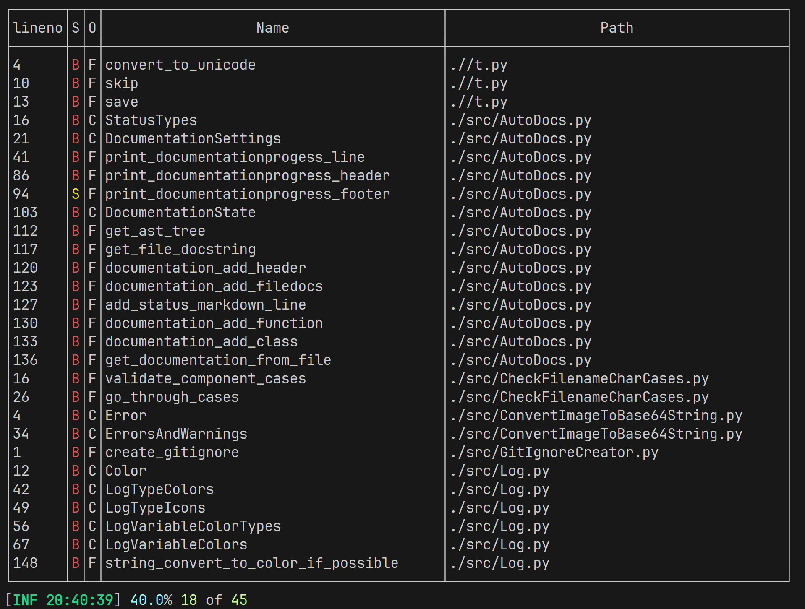
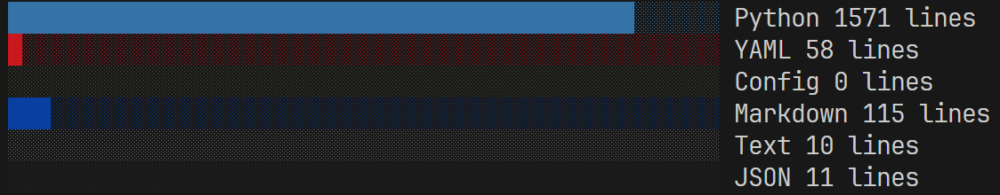
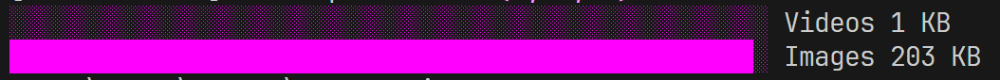
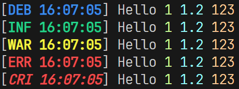

# My-Toolkit (\⁰⩐⁰/)

# AutoDocs
Ein Tool zum automatisieren von Readmes für z.B. GitHub.

# CodeStatistica
Zeigt an wie viele Lines in der Programmierung einzelner Sprachen gebraucht werden, mit einem prozentualen Balken.


Das gleiche auch für Assets nur ist es hier größenbasiert!


# ConvertImageToBase64String
# FileManager
# Log

Eine Loggingfunktion

```python
log('Hello $ $ $', [1, 1.2, '123'], LogTypes.debug)
log('Hello $ $ $', [1, 1.2, '123'], LogTypes.info)
log('Hello $ $ $', [1, 1.2, '123'], LogTypes.warning)
log('Hello $ $ $', [1, 1.2, '123'], LogTypes.error)
log('Hello $ $ $', [1, 1.2, '123'], LogTypes.critical)
```

resultiert in:



> Aktuell sind nur default pythontypen als variablenübergabe zugelassen, sonst crasht python. Fix kommt ASAP

# LoremIpsumGenerator
Falls ein Platzhalter benötigt wird.
```python
from src.LoremIpsumGenerator import lorem_ipsum_generator
print(
    lorem_ipsum_generator(p_word_count = 25)
)
```

Der Output ist:

**Lorem ipsum dolor sit amet, consetetur sadipscing elitr, sed diam nonumy eirmod tempor invidunt ut labore et dolore magna aliquyam 
erat, sed diam voluptua. At**

